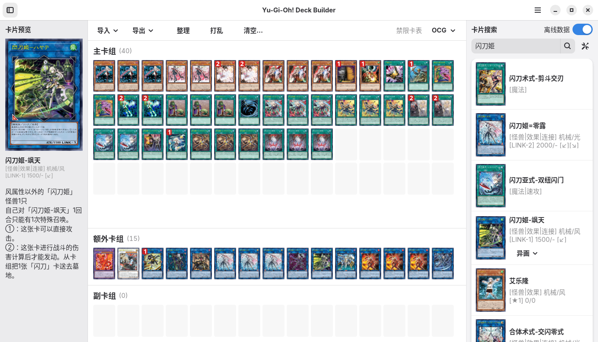

# YGODBR

YGODBR 是面向 Linux 的游戏王卡组编辑器，基于 GTK 4 和 libadwaita。



- 在线查卡，也可开启「离线数据」下载卡库并使用进阶筛选。支持先行卡和中英文界面。
- 拖放编辑卡组、切换异画，支持 OCG、TCG、亚洲英文和简体中文禁限卡表，以及 GENESYS 计分。
- 导入和导出 `.ydk` 文件或 [YGO-DA 卡组链接](docs/deck-url.md)，也可导出 PDF 卡表。

## 构建与运行

需要支持 C11 的编译器、Meson ≥ 0.59、Ninja、GTK ≥ 4.14 和 libadwaita ≥ 1.5。以下命令适用于 Ubuntu 24.04。

```sh
sudo apt install build-essential meson ninja-build pkg-config libglib2.0-dev \
  libgtk-4-dev libadwaita-1-dev libjson-glib-dev libsoup-3.0-dev \
  libgdk-pixbuf-2.0-dev libarchive-dev libsqlite3-dev libxml2-dev
```

在仓库根目录执行以下命令。

```sh
meson setup build
meson compile -C build
./build/src/ygo-deck-builder
```

运行测试用 `meson test -C build`。

## 安装与数据目录

执行 `sudo meson install -C build` 安装程序和桌面启动项。卸载时执行 `sudo ninja -C build uninstall`。

默认使用 XDG 目录。设置对应的环境变量可更改位置。

| 用途 | 环境变量 | 默认目录 |
| --- | --- | --- |
| 配置 | `XDG_CONFIG_HOME` | `~/.config/ygo-deck-builder/` |
| 卡库与禁限卡表 | `XDG_DATA_HOME` | `~/.local/share/ygo-deck-builder/` |
| 缓存 | `XDG_CACHE_HOME` | `~/.cache/ygo-deck-builder/` |

便携模式只需在可执行文件旁创建 `.portable`（例如 `touch build/src/.portable`）。下次启动时，程序会把配置、数据和缓存写入可执行文件所在目录。

## 许可证

[MIT](LICENSE)
